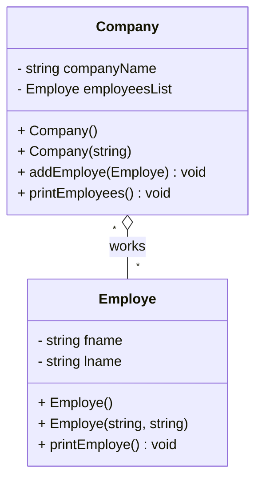
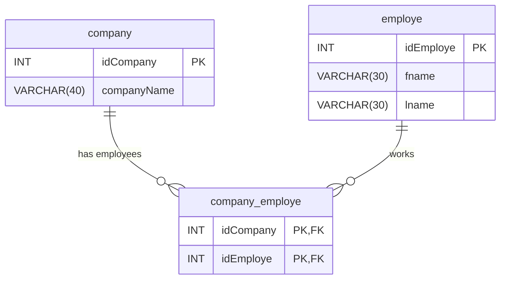

# Aggregaatio esimerkki

## Luokkakaavio

## Tietokanta

Jos tämän sovelluksen tapainen data pitäisi tallentaa Relaatiotietokantaan, niin ratkaisu olisi tällainen:

- Employe ja Company taulujen välillä yhteys monen suhde moneen. Tarvitaan siis välitystaulu.

### ER-kaavio

